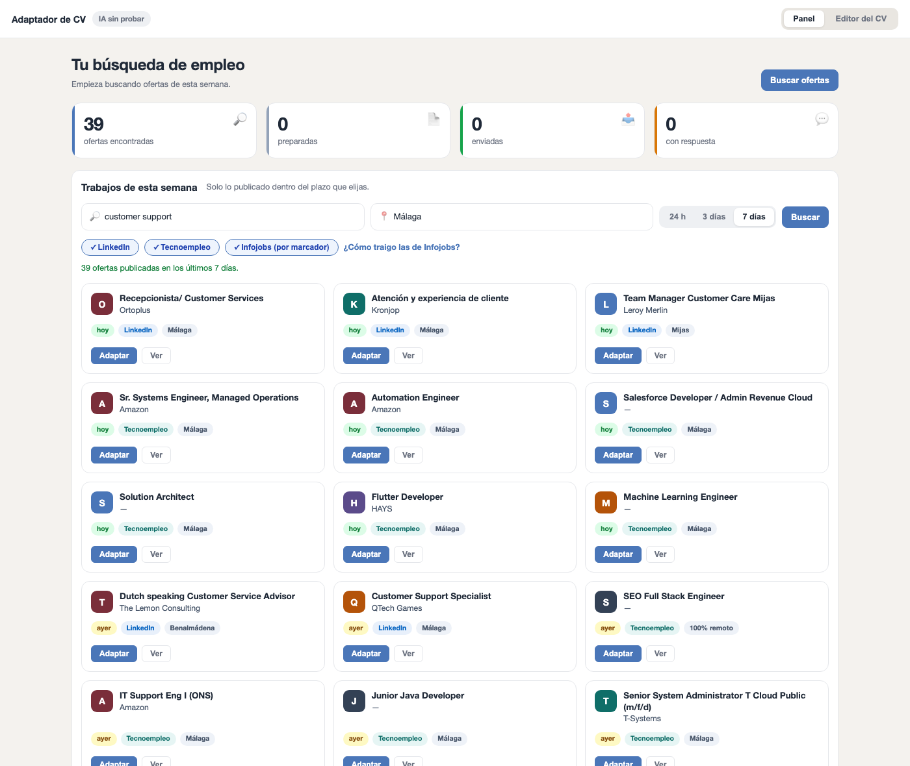
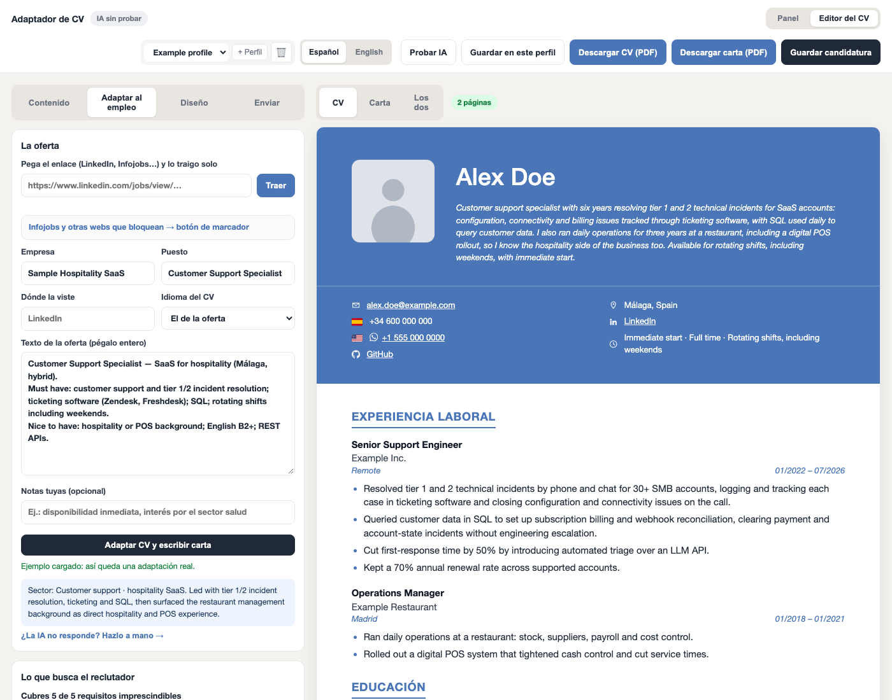
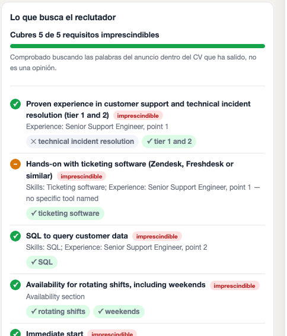

# CV Tailor

Rewrites your CV for one specific job posting using **only facts you already
have** — then checks the result against the advert's own wording and tells you
what is still missing.

Runs entirely on your machine. No account, no API key, no upload.



---

## The problem

Two failure modes ruin most applications.

The first is sending the same CV everywhere. A support role and a backend role
read the same history very differently, and a generic CV speaks to neither.
Rewriting it by hand for every posting takes twenty minutes, so nobody does it
past the third application.

The second is what happens when a language model is pointed at the problem.
Ask one to "tailor my CV to this job" and it will happily add the missing
requirement. That gets you an interview you cannot survive.

This tool takes the opposite constraint: **the model may reorder, reframe and
relabel, never add**. Everything it writes has to trace back to a fact already
in your profile. What you do not have shows up in red, as a gap, not as a
sentence in your CV.

---

## What it actually does

Given a job advert and your structured CV:

1. **Reads the advert.** Extracts 5–10 requirements, ranked, each marked
   `imprescindible` (hard requirement) or `valorable` (nice to have), with the
   literal words a screener would search for.
2. **Rewrites from that sector's point of view.** A restaurant management role
   gets stock, suppliers, cost control and shift work; the same history for a
   backend role gets schemas, APIs and deployments. Facts and figures stay
   identical — angle and vocabulary change.
3. **Verifies its own output.** After writing, the app searches the produced CV
   for each of the advert's keywords. Not the model's opinion: literal string
   matching, free and instant. You get `Covers 4 of 4 hard requirements` with a
   green tick per word.
4. **Recovers what it dropped.** If a keyword is missing from the new CV but
   present in one of your other profiles, the app says so and puts your original
   sentence back, verbatim. No model call — your words, unchanged.
5. **Writes the cover letter**, honest about gaps, and exports CV, letter, or
   both in one PDF.

The verification step is the part that matters. Step 2 alone is a chatbot;
step 3 is what makes the output trustworthy.



<p align="center">
  
</p>

The panel above is real output, not a mock-up: every screenshot in this README
comes from the sample profile shipped in the repo. Run `?demo=1` to reproduce it
without spending a model call.

> The UI is in Spanish — it targets the Spanish job market, where the adverts,
> the portals and the ATS keywords are Spanish. CV content is generated in the
> language of the advert, and a one-click ES ⇄ EN switch translates the whole
> document including section headings.

---

## Architecture

```
Browser (localhost:8765)
   │
   │  edit CV · paste a job link · adapt · export
   ▼
Python stdlib HTTP server  ──►  claude CLI (-p, JSON out)     the rewrite
   │                             uses the user's own Claude
   │                             subscription — no API key
   ├──►  Chrome --headless --print-to-pdf                     the PDF
   │
   ├──►  LinkedIn guest endpoints / JSON-LD JobPosting        job ingestion
   │
   └──►  perfiles/*.json                                      your CVs on disk
```

No framework, no database, no build step. `python3 servidor.py` and a browser.

### Why the `claude` CLI instead of an API key

The rewrite runs through Claude Code in print mode (`claude -p … --output-format
json`). That means it bills against a subscription the user already pays for
rather than an API key they would have to create, fund and rotate. Nothing
leaves the machine except the model call itself.

The trade-off is honest: a full adaptation takes around two and a half minutes,
and the CLI has to be logged in (`claude auth login`). When it is not, the app
falls back to a **manual mode** — copy the prompt, paste it into any Claude
window, paste the JSON back. Same result, zero setup.

### Why every template is a single column

Six templates ship, all with the body content in one column. Two-column CVs
with a sidebar look better and parse worse: many applicant tracking systems
read them in visual order and interleave your job titles with your skills.

An **ATS mode** checkbox goes further — drops the photo, the colour and the
flags, leaving plain text under standard headings for portals that parse badly.
Contact icons are inline SVG rather than emoji, so extracted text stays clean:
`+34 600 000 000`, not `🇪🇸+34 600 000 000`.

### Why job ingestion is three different paths

- **LinkedIn** publishes each posting through a guest endpoint that needs no
  session, including a date filter (`f_TPR=r86400`) — that is what powers the
  "last 24 h / 3 days / 7 days" search.
- **Most other portals** embed the posting as schema.org `JobPosting` JSON-LD.
  One parser covers all of them.
- **Some portals block automated reads** and their pages also block calls to
  `127.0.0.1` from the browser. For those there is a **bookmarklet**: it scrapes
  the page the user is already looking at, tries to POST it to the local app,
  and falls back to the clipboard when the site's policy forbids that. No
  scraping of sites that say no, no credentials involved.

### Chrome headless is not a print button

Two behaviours cost real debugging time and are worth knowing:

- Chrome writes the PDF and then **does not exit**. Waiting on the process
  hangs forever; the fix is to poll until the file stops growing and terminate
  it yourself.
- `--headless=new` **fails on a locked or sleeping Mac**
  (`CVDisplayLinkCreateWithCGDisplay failed`). The app retries with
  `--headless=old`, which needs no display services, and explains the cause if
  both fail.

### Page count is measured, not estimated

"Fit in two pages" is verified by rendering the real PDF and counting its pages,
then binary-searching the largest font size that still fits. The live preview
also estimates page breaks by simulating block-level pagination — dividing total
height by page height is wrong, because blocks do not split and chips flow in
rows. The estimator is calibrated against real PDFs at four font sizes.

---

## MVP — what works today

| Area | Status |
|---|---|
| Structured CV editor, live A4 preview | ✅ |
| 6 single-column templates + ATS mode, colour, size, section order | ✅ |
| Photo upload — any size/format → square, sRGB, 900×900 (`sips`) | ✅ |
| Multiple base profiles (one per job family) | ✅ |
| Job ingestion by link: LinkedIn, JSON-LD portals, bookmarklet | ✅ |
| Weekly job search with 24 h / 3 d / 7 d filter | ✅ |
| Sector-aware rewrite with a no-invention constraint | ✅ |
| Requirement triage + literal keyword coverage check | ✅ |
| Gap recovery from other profiles, verbatim, no model call | ✅ |
| Cover letter, editable, exported alongside the CV | ✅ |
| PDF export: CV, letter, or both in one file | ✅ |
| Auto-fit to two pages, verified against the real PDF | ✅ |
| ES ⇄ EN translation, section headings included | ✅ |
| Application tracker: prepared → sent → replied → interview | ✅ |
| Email draft with the PDFs attached (macOS Mail) | ✅ |

## Roadmap

- **Fit score before applying** — run the requirement analysis over a whole
  search and rank postings by how well the profile already covers them, so the
  twenty minutes go to the three worth applying to.
- **Interview prep from the same analysis** — the gaps found while adapting are
  exactly the questions that will come up.
- **Follow-up reminders** per application, driven by the tracker.
- **`.docx` export** for portals that reject PDFs.
- **Pluggable engine** — a local model (Ollama) as an alternative to the CLI,
  for people without a Claude subscription.
- **Golden-file tests** for rendering and a small regression suite for prompts.
- **Linux/Windows support** — today the PDF path assumes macOS Chrome and the
  photo pipeline uses `sips`.

## Known limits

- Portal scrapers break when a site changes its markup. Failures are reported,
  never silent, and pasting the text by hand always works.
- Keyword coverage is literal, so it measures *screenability*, not suitability:
  a CV saying "English C1" scores a miss against an advert asking for "B2" even
  though it exceeds it. The per-requirement verdict covers that; the bar does
  not.
- One adaptation ≈ 2.5 min. It is a considered rewrite of a whole document, not
  an autocomplete.
- Anything you add through "I have this" is your responsibility. The tool
  refuses to invent; it cannot stop you from doing it.

---

## Running it

Requirements: macOS, Python 3 (system one is fine), Google Chrome, and
[Claude Code](https://claude.com/claude-code) logged in for the AI features.

```bash
git clone https://github.com/Borinken/cv-tailor.git
cd cv-tailor
cp cv_base.ejemplo.json cv_base.json     # then edit it with your own data
python3 servidor.py                      # http://127.0.0.1:8765
```

Want to see it working before filling in your own data? Open
`http://127.0.0.1:8765/?demo=1` — it loads a real saved adaptation, no model
call and no setup.

On macOS, double-clicking `arrancar.command` does the same thing.

`LEEME.md` is the end-user guide, in Spanish.

## Layout

```
servidor.py            HTTP server, rendering, PDF, prompts, job ingestion
web/                   single-page UI (no framework, no build)
  ├── index.html
  ├── app.js           editor, dashboard, adaptation flow
  ├── estilos.css
  └── marcador.js      bookmarklet source, served and wrapped at runtime
cv_base.ejemplo.json   sample profile — copy it, do not edit it
perfiles/              your CV profiles          (git-ignored)
datos/                 your photos               (git-ignored)
salidas/               saved applications + PDFs (git-ignored)
```

Personal data never enters the repository: profiles, photos and saved
applications are all ignored by git. What is versioned is the tool.

## Privacy

Your CV, your photo and your applications stay in the project folder. The only
outbound traffic is the model call made by the `claude` CLI and the job pages
you explicitly ask it to fetch. There is no account, no telemetry and no
server other than the one running on your own port.

---

MIT © Borinken
